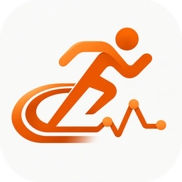
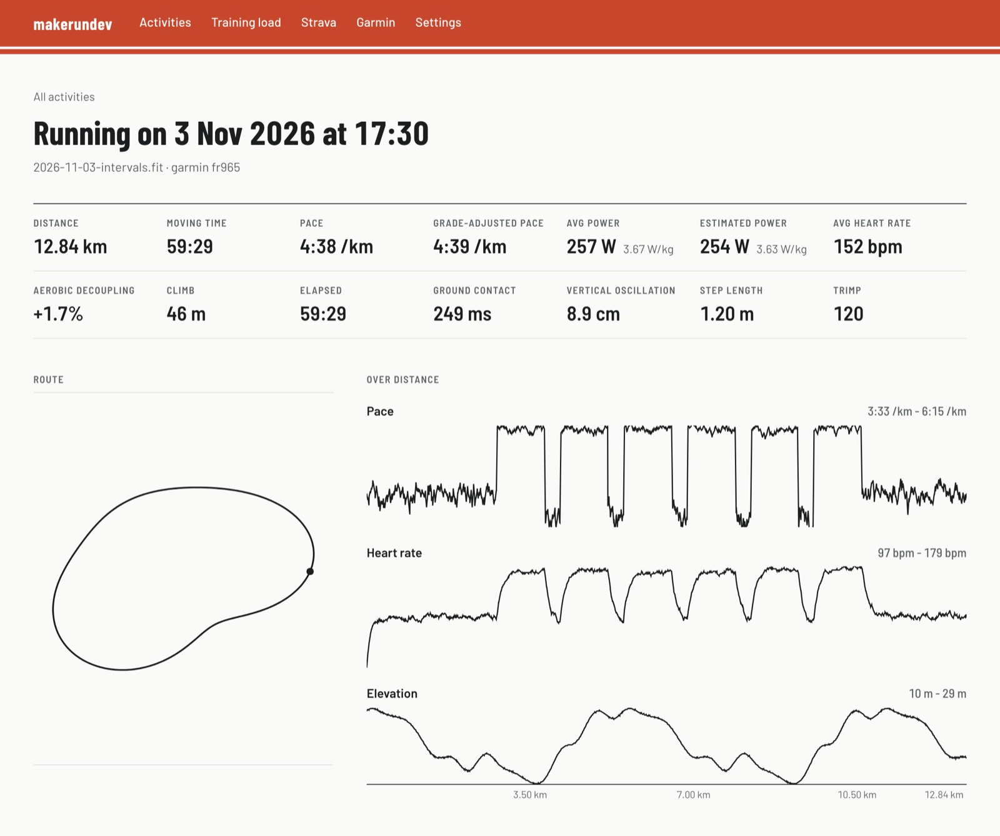
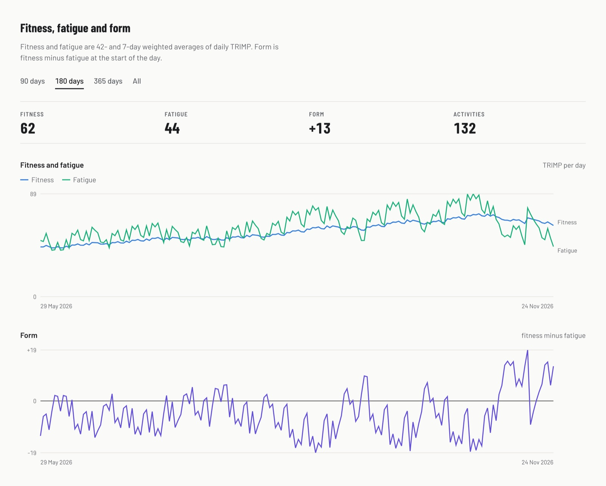

<picture>
  <source media="(prefers-color-scheme: dark)" srcset="docs/images/icon-dark-256.png">
  
</picture>

# makerundev

[](https://github.com/tanhtruong/makerundev/actions/workflows/ci.yml)
[](https://pypi.org/project/makerundev/)
[](pyproject.toml)
[](LICENSE)

**Your watch records every second of every run. makerundev gives all of it back to you.**

makerundev reads the activity files that Garmin, Coros, Suunto, Polar and Wahoo watches produce (FIT, GPX, TCX), turns them into one clean per-second record stream, and computes the numbers runners care about: pace and grade-adjusted pace, climb, best efforts, heart-rate zones, TRIMP, aerobic decoupling and fitness, fatigue and form. Use it as a Python library and CLI, or run the self-hosted web app on your own machine.

<picture>
  <source media="(prefers-color-scheme: dark)" srcset="docs/images/activity-dark.jpg">
  
</picture>

## Why makerundev

- **Your data stays yours.** No account, no cloud, no subscription. The app is one process with SQLite and files on your disk, and it loads nothing from the internet.
- **Metrics you can check.** Every metric has a written definition in the [glossary](GLOSSARY.md) and tests with hand-computed values. When a definition changes, the [changelog](CHANGELOG.md) says how your numbers shift.
- **Any watch, one shape.** FIT, GPX and TCX files, plain, gzipped or zipped, all become the same table in the same units. Nothing downstream needs to know which watch you wore.
- **Made to be poked at.** The record stream is a [polars](https://pola.rs) DataFrame. Export it to Parquet or CSV and take it into a notebook, DuckDB or a spreadsheet.

> **Status: pre-alpha.** File import, Strava and Garmin Connect sync, the metrics below and the web app work today.

## Try it in 30 seconds

With [uv](https://docs.astral.sh/uv/), point makerundev at any activity files, no install needed:

```bash
uvx makerundev summary ~/Downloads/*.fit
```

```text
2026-10-11-long.fit  2026-10-11 05:30  running  17.64 km  1:30:55  5:09 /km  152 bpm  +151 m
2026-10-13-intervals.fit  2026-10-13 05:30  running  13.46 km  1:00:55  4:31 /km  153 bpm  +121 m
2026-10-15-tempo.fit  2026-10-15 05:30  running  14.49 km  1:04:55  4:29 /km  157 bpm  +121 m
```

Add `--long` for grade-adjusted pace and aerobic decoupling at the end of each line:

```text
2026-10-11-long.fit  2026-10-11 05:30  running  17.64 km  1:30:55  5:09 /km  152 bpm  +151 m  GAP 5:03 /km  decoupling +3.1%
```

Add your body mass in kg too and each line ends with estimated power, the watts a power meter would report, worked out from speed, grade and body mass rather than measured (see the [glossary](GLOSSARY.md)):

```bash
uvx makerundev summary --long --body-mass 70 2026-10-11-long.fit
```

```text
2026-10-11-long.fit  2026-10-11 05:30  running  17.64 km  1:30:55  5:09 /km  152 bpm  +151 m  GAP 5:03 /km  decoupling +3.1%  est. power 231 W
```

Prefer miles? Pass `--units mi` to `summary`, `splits` or `laps`, or set `MAKERUNDEV_UNITS=mi` once:

```text
2026-10-11-long.fit  2026-10-11 05:30  running  10.96 mi  1:30:55  8:18 /mi  152 bpm  +151 m
```

Find the best efforts hiding inside a run:

```bash
uvx makerundev efforts race.fit
```

```text
         400 m  1:34
          1 km  3:56
        1 mile  6:21
          3 km  11:52
          5 km  19:53
         10 km  39:48
 Half marathon  1:24:04
```

Or the moving time and pace of every kilometre with `uvx makerundev splits race.fit`, or of every mile with `uvx makerundev splits --units mi race.fit`.

Or each lap your watch recorded, with its distance, time and pace: `uvx makerundev laps race.fit`.

The time in each heart-rate zone, from your max heart rate (zones start at 60, 70, 80 and 90 % of it unless you pass `--thresholds`):

```bash
uvx makerundev zones race.fit --max-hr 190
```

And the Banister TRIMP training load, as a whole number (`--female` for the female coefficients):

```bash
uvx makerundev trimp race.fit --max-hr 190 --resting-hr 50
```

And get the whole normalised record stream out as Parquet or CSV:

```bash
uvx makerundev export race.fit race.parquet
```

Before you attach a GPX or TCX file to a bug report, move it far from home. Every position is shifted by one random turn of the globe, so distances, times, heart rate and everything else in the file stay as they were:

```bash
uvx makerundev anonymize run.gpx shifted.gpx
```

It lists what else in the file could identify you, such as names, an author or a device serial, so you can check those by hand. Comments and coordinates under other names are left as they are. FIT files are not supported yet.

Prefer pip? `pip install makerundev` gives you the same `makerundev` command and the library.

## Run your own dashboard

The web app turns a folder of activity files into a private training log: every run with its charts, best efforts, time in zones and TRIMP, plus your fitness, fatigue and form over months.

With [uv](https://docs.astral.sh/uv/), start it straight from PyPI:

```bash
uvx makerundev-server
```

It keeps the database and your files in `data/` under the folder you start it from; set `MAKERUNDEV_DATA_DIR` to keep them elsewhere. `pip install makerundev-server` gives you the same command.

Or with Docker, from the image published with each release:

```bash
docker run --name makerundev -p 127.0.0.1:8000:8000 -v makerundev-data:/data ghcr.io/tanhtruong/makerundev-server
```

To work on the app, run it from a clone (`docker compose up` there builds the image from the checkout):

```bash
git clone https://github.com/tanhtruong/makerundev.git && cd makerundev
uv sync
uv run makerundev-server
```

From a clone, the app's pages say how to build them until you run `make sync-web` and `make build-web` once (Node and pnpm, see [docs/frontend.md](docs/frontend.md)); the JSON API works without it.

Then open http://127.0.0.1:8000 and:

1. **Import** your files at the top of the activity list. Select as many as you like, gzipped ones from a Strava export included; files already imported are skipped. Or sync from [Strava](#sync-from-strava) or [Garmin Connect](#sync-from-garmin-connect).
2. **Set your heart rate** under Settings: max and resting heart rate, TRIMP coefficients, zones and timezone. makerundev works out TRIMP for every activity and keeps it up to date when you change them. Add your body mass too, and every run shows its estimated power next to any power your watch recorded.
3. **Open Training load** to see fitness, fatigue and form built from your daily TRIMP.

<picture>
  <source media="(prefers-color-scheme: dark)" srcset="docs/images/load-dark.jpg">
  
</picture>

The app has no login, so keep it on `127.0.0.1` or behind a reverse proxy that adds authentication. It refuses form posts and API writes that another website makes your browser send. Configuration, data layout, backups and the JSON API are in the [server README](apps/server/README.md).

### Sync from Strava

Sync uses a Strava API application that you create yourself, so your activities move only between Strava and your machine.

1. On Strava, open [Settings → My API Application](https://www.strava.com/settings/api) and create an application. Set its **Authorization Callback Domain** to the host you open makerundev on, such as `127.0.0.1`.
2. Start the app with the application's client id and secret:

   ```bash
   MAKERUNDEV_STRAVA_CLIENT_ID=12345 MAKERUNDEV_STRAVA_CLIENT_SECRET=... uvx makerundev-server
   ```

3. Open **Strava** in the app, choose **Connect with Strava**, then **Sync now**.

Each sync brings in what is new and then works back through your history, newest first. Strava allows a new application 100 requests per 15 minutes and 1,000 per day, and each activity takes two (its streams and its laps), so a long history takes a few syncs; the page says when to come back. An activity you already imported from a file is recognised and not duplicated. The [server README](apps/server/README.md#strava-sync) has the details.

### Sync from Garmin Connect

Garmin sync uses a Personal API key that you create for your own account, so your activities move only between Garmin and your machine.

1. In Garmin Connect on the web, open **Settings → Personal API Key** and create a key. Garmin shows it once.
2. Open **Garmin** in the app, paste the key, then choose **Sync now**.

Each activity comes in as the original file your watch recorded, as if you had uploaded it, with laps and running dynamics. A sync takes about a second per activity, so a long history takes a few minutes, and the next sync picks up where the last one stopped. Activities you already have, from a file or a Garmin export, are not downloaded again. When the key expires, the page says so; create a new one and paste it in. The [server README](apps/server/README.md#garmin-sync) has the details.

## What it measures

| Metric | What it tells you |
| --- | --- |
| Distance, elapsed and moving time, pace | The basics, with pauses and GPS dropouts kept out of moving time |
| Grade-adjusted pace | Your pace as if the route were flat, from the Minetti energy-cost model |
| Estimated power | The watts a running power meter would show, from your speed, the gradient and your body mass, with or without a meter |
| Climb and descent | Elevation gain and loss, with altimeter noise filtered out |
| Best efforts | Your fastest 400 m, 1 km, mile, 3 km, 5 km, 10 km, half and marathon within any run |
| Splits | Moving time and pace for every kilometre or mile, and for the distance left over at the end |
| Laps | The laps your watch recorded, with each lap's time, distance and pace |
| Time in heart-rate zones | How long you spent in each zone, from thresholds you choose |
| TRIMP | Banister's training impulse: one number for how hard a session was |
| Aerobic decoupling | How much your speed per heartbeat dropped from the first half of a run to the second |
| Fitness, fatigue and form | 42- and 7-day weighted averages of daily load, and the gap between them |

The exact definitions, thresholds and formulas are in the [glossary](GLOSSARY.md).

## Using the library

```bash
pip install makerundev
```

```python
from makerundev import load
from makerundev.metrics import (
    aerobic_decoupling,
    best_efforts,
    grade_adjusted_pace,
    splits,
    summarize,
    time_in_zones,
    training_load,
    trimp,
)

# FIT, GPX or TCX, plain, .gz, or a .zip holding one of them
activity = load("long-run.fit")
# polars DataFrame, one row per sample
activity.records

# Summary(distance_m=17642.38, moving_s=5455.0, pace_s_per_km=309.2, ...)
summarize(activity)
# 306.8 (s/km, or None when altitude is missing)
grade_adjusted_pace(activity)
# {400.0: 121.6, 1000.0: 306.0, 1609.344: 493.9, 3000.0: 920.4, 5000.0: 1539.6, 10000.0: 3088.2}
best_efforts(activity)
# [Split(distance_m=1000.0, elapsed_s=312.0, moving_s=312.0, pace_s_per_km=312.0), ...]
splits(activity)
# seconds per zone: [15.0, 45.0, 1000.0, 4395.0, 0.0]
time_in_zones(activity, [113, 132, 150, 169])
# 180.6
trimp(activity, resting_hr=48, max_hr=188)
# 3.8 (%)
aerobic_decoupling(activity)

# {date: TRIMP} in, polars DataFrame out:
# date, load, fitness, fatigue and form for every day
training_load(daily_trimp)
```

The record stream has the same columns and units whatever the source file:

| Column | Unit |
| --- | --- |
| `timestamp` | UTC |
| `latitude`, `longitude` | degrees |
| `distance`, `altitude` | metres |
| `speed` | m/s |
| `heart_rate` | bpm |
| `cadence` | steps/min, both feet |
| `power` | watts |
| `temperature` | °C |
| `ground_contact_time` | ms |
| `vertical_oscillation` | mm |
| `step_length` | metres |

## Getting your data out of your watch

- **Garmin**: Garmin Connect → activity → ⚙ → *Export Original* gives a ZIP holding the FIT file, which makerundev imports as it is. For everything at once, request a data export from your Garmin account's data management page.
- **Strava**: Settings → My Account → *Download or Delete Your Account* → *Request your archive*. The `activities/` folder holds `.fit.gz`, `.gpx.gz` and `.tcx.gz` files, which makerundev imports as they are.
- **Coros, Suunto, Polar, Wahoo**: each app can export single activities as FIT.

## Roadmap

Done: parsers and the record stream, core metrics and the CLI, the web app, athlete settings with zones and TRIMP, the training load page, database migrations, Strava and Garmin Connect sync, ZIP import, laps, splits, running dynamics, the route shape, critical speed, VDOT and running power without a power meter. Next, roughly in order:

- In the app: a map view, search and filters

Not planned: social feeds, segment leaderboards, hosting other people's data or generating training plans. The [v1 spec](docs/v1-spec.md) has the full scope and reasoning.

## Contributing

Bug reports, file-format edge cases, metric ideas and code are all welcome. The most useful thing you can send is a file makerundev gets wrong (shift or strip the GPS track first). Setup is `uv sync` and `make check`; [CONTRIBUTING.md](CONTRIBUTING.md) has the rest, including what a metric change needs, and [docs/frontend.md](docs/frontend.md) covers the React app.

## Documentation

- [v1 spec](docs/v1-spec.md) - scope, data sources and build order
- [Glossary](GLOSSARY.md) - every term and metric definition
- [Architecture decisions](docs/adr) - why things are the way they are
- [Server README](apps/server/README.md) - configuration, data, routes and migrations
- [The web app](docs/frontend.md) - the React app, its commands and structure
- [Changelog](CHANGELOG.md) - what changed in each release

## License

[Apache-2.0](LICENSE)
